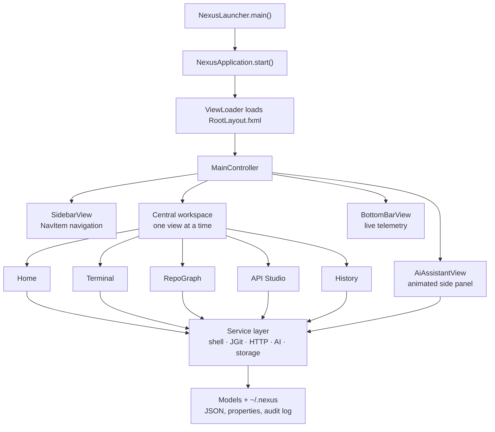
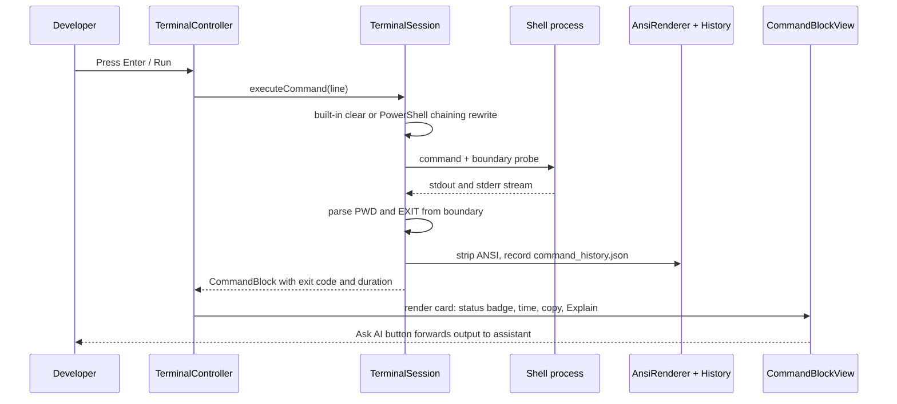
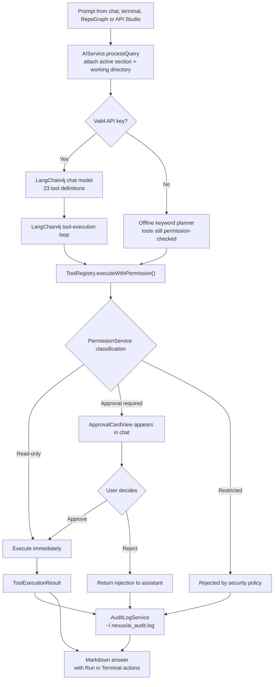
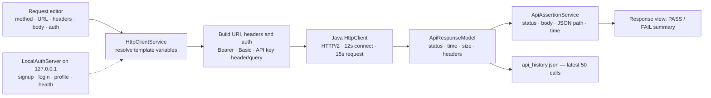
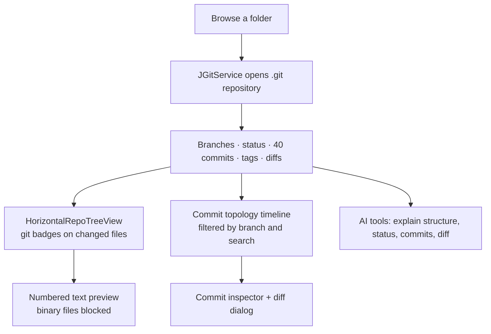
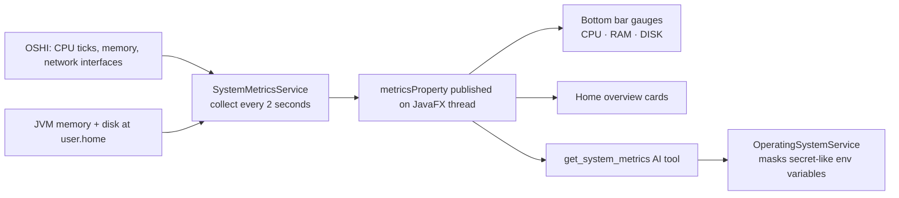

<div align="center">

# NEXUS

### *One workspace for the way developers actually work.*

**Terminal · Repository intelligence · API Studio · AI assistant · Live telemetry**

**Team 8 · CSE 309: Advanced Java Programming · SRM University AP**


</div>

---

## What is NEXUS?

NEXUS is a **JavaFX desktop workspace** that brings the tools developers switch between all day into a single, keyboard-friendly window. It runs real shell sessions, explores Git repositories without leaving the app, sends and validates HTTP requests, and pairs all of it with an AI assistant that can act on your workspace — but only after your permission.

> **Design principle:** *the assistant is a teammate, not an admin.* Every file write, command, Git checkout or mutating API call is classified and either auto-approved, blocked, or presented to you as an approval card in the chat.

| | Module | In one line |
|---|---|---|
| 🖥️ | **Terminal** | Persistent PowerShell / CMD / Bash sessions with tabs, ANSI cleanup, history and per-command cards. |
| 🌿 | **RepoGraph** | Horizontal repository tree, file previews, branches, working-tree status, commit topology and diffs via JGit. |
| ⚡ | **API Studio** | HTTP requests with auth, variables, collections, five assertion types and OpenAPI import. |
| 🤖 | **AI Assistant** | Context-aware chat with **23 tools**, three permission levels and a tamper-evident audit log. |
| 📊 | **History & Telemetry** | Searchable command analytics and live CPU / RAM / disk / network readings from OSHI. |

---

## Contents

- [Highlights](#highlights)
- [Architecture](#architecture)
- [How it works — flow diagrams](#how-it-works--flow-diagrams)
- [Feature map](#feature-map)
- [Technology stack](#technology-stack)
- [Repository layout](#repository-layout)
- [Quick start](#quick-start)
- [Configuration](#configuration)
- [Team & contributions](#team--contributions)
- [Deliverables](#deliverables)
- [Scope & roadmap](#scope--roadmap)

---

## Highlights

- **Real shells, not a toy console.** Each tab is a live `ProcessBuilder` session with its own working directory, remote POSIX/CMD/PowerShell boundary probes for exit codes and `pwd`, Ctrl+C cancellation, tab renaming and restart.
- **Permission-gated AI tooling.** 23 `@Tool` methods span filesystem, shell, OS, Git, project discovery and HTTP. Sensitive paths and destructive commands are *restricted* before execution; writes and mutations require an in-chat approval card.
- **Repository intelligence powered by JGit.** Branch lists, status buckets, 40-commit history with tags and changed files, and commit diffs — all in-process, no external `git` binary needed.
- **An API workbench with tests built in.** `{{variable}}` substitution across environments, five auth modes, JSON-path assertions, response-time checks, saved collections and JSON/YAML OpenAPI import.
- **Live system sensing.** OSHI samples CPU, memory, disk and network every two seconds and publishes to the bottom bar, home cards and the AI tool layer.
- **Five dark themes.** Matte Black & Gold by default, plus Festive, Cyberpunk, Midnight Sapphire and Emerald Matrix, persisted in `java.util.prefs`.
- **Local-first persistence.** Commands, API collections, history, environments and audit records live under `~/.nexus` — no server required to launch.

---

## Architecture

The application boots once into a persistent shell (sidebar + bottom bar + AI panel) and swaps only the central workspace view as you navigate.



All ten FXML views are created through a single `ViewLoader`; the five workspace views are instantiated at startup into an `EnumMap` keyed by `NavItem`, so switching sections is a fade-in rather than a fresh construction. `NavigationService` is the shared router used by the sidebar, home quick-actions, global search and cross-module **"Ask AI"** buttons.

---

## How it works — flow diagrams

### 1 · A command from keystroke to card

Terminal output is streamed from the shell process, delimited by an injected probe that reports the final working directory and exit code. That is how NEXUS keeps tabs stateful across `cd` commands.



### 2 · A prompt, 23 tools and the permission gate

This is the core safety path. The LLM receives tool definitions; NEXUS receives the decision.



Permission levels in practice:

| Level | Examples | Behaviour |
|---|---|---|
| 🟢 **Read-only** | `list_directory`, `read_file`, `get_git_status`, `GET` requests, `get_system_metrics` | Runs automatically, still audited. |
| 🟡 **Approval required** | Every terminal command, `create_file`, `modify_file`, `delete_file`, Git checkout, `POST`/`PUT`/`PATCH`/`DELETE` | Waits for an in-chat **Approve & Execute** / **Reject** card. |
| 🔴 **Restricted** | SSH keys, `.env`, credential stores, `rm -rf /`, `mkfs`, `diskpart`, shutdown, pipe-to-shell downloads | Blocked before any tool runs. |

### 3 · An API request and its assertions



If a successful response contains a top-level `token`, API Studio stores it in the active environment so the next request can use `{{token}}`.

### 4 · Repository exploration with JGit



Non-Git folders still work: NEXUS falls back to a local workspace view with a synthetic `HEAD-LOCAL` node.

### 5 · Telemetry pipeline



---

## Feature map

| Module | View / controller | Core services | What it really does |
|---|---|---|---|
| 🏠 Home | `HomeView.fxml` · `HomeController` | `NavigationService`, `SystemMetricsService`, `CommandHistoryService` | Quick actions, live resource cards, recent command activity. |
| 🖥️ Terminal | `TerminalView.fxml` · `TerminalController` | `TerminalSession`, `TerminalProcessManager`, `ShellDetector`, `AnsiRenderer` | Multiple real shells, tabs, history navigation (↑/↓), Ctrl+C / Ctrl+L, font sizing, expand mode, "Explain" output. |
| 🌿 RepoGraph | `RepoGraphView.fxml` · `RepoGraphController` | `JGitService`, `FileSystemService`, `HorizontalRepoTreeView` | Tree and commit views, search, zoom, checkout, diff dialog, file preview, copy path/content. |
| ⚡ API Studio | `ApiStudioView.fxml` · `ApiStudioController` | `HttpClientService`, `ApiAssertionService`, `EnvironmentService`, `OpenApiImportService`, `LocalAuthServer` | Seven HTTP methods, five auth modes, collections, environments, assertions, history, OpenAPI import. |
| 🤖 Assistant | `AiAssistantView.fxml` · `AiAssistantController` | `AIService`, `LLMProviderService`, `ToolRegistry`, `PermissionService`, `AuditLogService` | Context-aware chat, Markdown rendering, runnable code blocks, approval cards, task steps, 40-message session history. |
| 📊 History | `HistoryView.fxml` · `HistoryController` | `CommandHistoryService` | Filter by tool, search command/directory, success rate, average duration, most-used tool, clear history. |
| ⚙️ Settings | `SettingsDialog.fxml` · `SettingsDialogController` | `ThemeService` | Five persisted dark palettes with live swatch preview and font selection. |

---

## Technology stack

| Layer | Choices |
|---|---|
| Language & UI | Java **21**, JavaFX **21.0.2** (Controls, FXML, Graphics, Base), FXML + CSS |
| Build | Apache Maven, Compiler plugin 3.13.0, JavaFX Maven plugin, Shade plugin for the fat JAR |
| AI | LangChain4j **0.35.0** + OpenAI integration, Jackson for tool/JSON handling |
| Git | JGit **6.9.0** (in-process); shell `git` remains available through the integrated terminal |
| HTTP & data | Java `HttpClient` (HTTP/2), Jackson YAML for OpenAPI, Gson for command history |
| System | OSHI **6.6.5**, JANSI, `OperatingSystemService` for AI-visible process/OS data |
| Persistence | Local JSON + properties under `~/.nexus`, Java preferences for themes, optional MySQL Connector/J 8.4.0 |

---

## Repository layout

```text
.
├── README.md                    ← you are here
├── A08_Project_Report.pdf       ← architecture, file allocation, screenshots
├── Video Demonstration.mp4      ← full walkthrough
└── Project Codes/
    ├── pom.xml
    ├── README.md                ← detailed setup and configuration
    ├── .gitignore
    └── src/main/
        ├── java/com/nexus/
        │   ├── app/             NexusApplication, NexusLauncher
        │   ├── config/          AppConfig constants
        │   ├── controller/      FXML controllers and event handling
        │   ├── service/         Shell, Git, HTTP, AI, permission and storage logic
        │   ├── model/           Data models and enums
        │   ├── component/       Reusable JavaFX cards, badges, trees, gauges
        │   └── util/            ViewLoader, Markdown/ANSI rendering, UI helpers
        └── resources/
            ├── views/           10 FXML views
            ├── styles/          nexus-theme.css
            └── icons/           nexus-icon.png
```

> `target/` is Maven build output and is intentionally excluded from Git. Rebuild it with `mvn clean compile`.

---

## Quick start

**Prerequisites:** JDK 21, Maven 3.9+, a desktop environment for JavaFX, and internet access for the first dependency download.

```bash
cd "Project Codes"
mvn clean compile
mvn javafx:run
```

To produce a standalone executable JAR (built for the platform you run Maven on):

```bash
mvn package
java -jar target/nexus-workspace-1.0.0-SNAPSHOT.jar
```

The UI opens without an API key or database. Live AI answers need a provider key; everything else works offline.

---

## Configuration

Create `~/.nexus/config.properties` (Windows: `%USERPROFILE%\.nexus\config.properties`) for an OpenAI-compatible provider:

```properties
ai.api.key=YOUR_API_KEY
ai.base.url=https://api.groq.com/openai/v1
ai.model.name=YOUR_PROVIDER_MODEL_ID
```

Defaults are `https://api.openai.com/v1` and `gpt-4o-mini`. Environment variables take precedence:

| Purpose | Variables |
|---|---|
| AI | `OPENAI_API_KEY` / `NEXUS_AI_API_KEY`, `OPENAI_BASE_URL` / `NEXUS_AI_BASE_URL`, `OPENAI_MODEL_NAME` / `NEXUS_AI_MODEL` |
| Optional MySQL | `NEXUS_DB_HOST`, `NEXUS_DB_PORT`, `NEXUS_DB_NAME`, `NEXUS_DB_USER`, `NEXUS_DB_PASSWORD` |

Local runtime data:

| File | Contents |
|---|---|
| `~/.nexus/command_history.json` | Commands, directory, status, exit code, duration, tool category |
| `~/.nexus/api_collections.json` | Saved requests and demo collections |
| `~/.nexus/api_environments.json` | Variables such as `baseUrl`, `token`, `authUrl` |
| `~/.nexus/api_history.json` | Last 50 API executions |
| `~/.nexus/ai_audit.log` | Every permission decision and tool result |
| `~/.nexus/config.properties` | AI and optional database settings |

---

## Team & contributions

**Team 8 · CSE 309: Advanced Java Programming · SRM University AP**

| Member | Registration number |
|---|---|
| Ch. Rohit | AP24110010986 |
| M. NagaSai Rishi | AP24110011126 |
| K. Bhavanadithya | AP24110010929 |

| Member | Responsibilities |
|---|---|
| **Ch. Rohit** | Application startup, navigation, terminal execution, command history and live system monitoring. |
| **M. NagaSai Rishi** | Repository exploration, assistant presentation, file and project services, conversation models and shared view infrastructure. |
| **K. Bhavanadithya** | API request execution and validation, environment handling, AI tool execution, permission checks and the JDBC service. |

The report allocates **25 of the 75 application Java files to each member**; interface integration and the final demonstration are shared responsibilities.

---

## Deliverables

| Item | Link |
|---|---|
| 📄 Project report | [A08_Project_Report.pdf](A08_Project_Report.pdf) |
| 💻 Working source | [Project Codes](Project%20Codes/) |
| 📖 Setup & configuration | [Code README](Project%20Codes/README.md) |
| 🎬 Walkthrough | [Video Demonstration.mp4](Video%20Demonstration.mp4) |

---

## Scope & roadmap

Implemented and documented in the report: the five workspace modules, tool-calling with permission checks and audit logging, JGit-based repository intelligence, API assertions and OpenAPI import, local persistence and live monitoring.

Known boundaries: AI replies are not streamed and the LLM conversation is scoped to a single request; MySQL schema code exists but active storage is local JSON; a few settings controls are visual placeholders. Planned extensions are **Compiler Studio**, structural dependency mapping and predictive command recommendations.

---

<div align="center">

*Built with Java 21, JavaFX and a lot of coffee — Team 8, CSE 309.*

</div>
